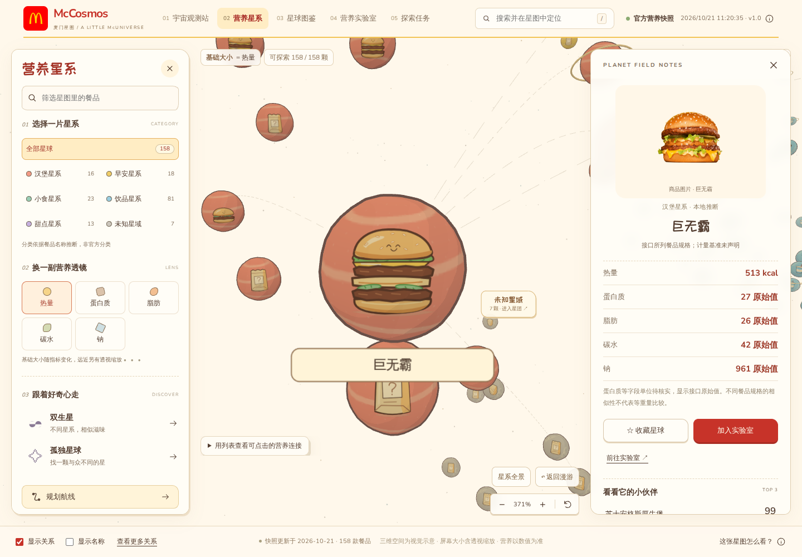

# McCosmos · 麦门星图

把日常的一口，装进小小宇宙。浅色卡通绘本风的麦当劳营养探索应用，让餐品变成星球，用营养透镜发现彼此的连接。

适合想直观看懂餐品营养、喜欢交互图鉴的用户，以及复用 MCP 分析能力的 Agent 开发者。独立参赛作品，非麦当劳官方产品；信息以官方渠道为准。

[在线探索](https://mccosmos.pages.dev) · [Actions 与静态包](https://github.com/ayingQAQ/McCosmos/actions/workflows/ci.yml) · [实际 MCP 接入](MCP_INTEGRATION.md) · [Skill](skills/mccosmos/SKILL.md) · [实施记录](docs/IMPLEMENTATION_LOG.md)

2.0 新增五个互通的探索站：[观测站](https://mccosmos.pages.dev/) → [营养星系](https://mccosmos.pages.dev/galaxy) → [星球图鉴](https://mccosmos.pages.dev/atlas) → [实验室](https://mccosmos.pages.dev/lab) → [探索任务](https://mccosmos.pages.dev/quests)。交互路径与验收记录见 [USER_JOURNEYS](docs/USER_JOURNEYS.md)。





## 食物星球与真实商品照片

宇宙使用奶油纸色、麦当劳红与暖金色。卡通餐品图案附在 **受光照的真实三维球体表面**，保留弧面、明暗交界与立体星环；图案映射到贴合球面的三维网格，参与光照、透视、遮挡和雾化，拾取对应三维球体；旋转、平移、相机飞行继续工作。营养指标只改变尺寸，不重排位置。图鉴与档案则显示有来源的真实商品图片，两类视觉资产各司其职。

当前 158 款营养餐品中，**112 款可显示商品图片**（86 款准确对应/已核对别名，26 款同款不同尺寸参考）。菜单图片来自 MCP `query-meals` 和 `query-meal-detail`，采样门店为上海黄浦华旭国际大厦餐厅（1450713），含早餐预约菜单；不代表用户所在地、全国实时菜单或库存。冰、热焦糖玛奇朵另外使用各自麦当劳中国官网商品页图片。`list-nutrition-foods` 不含图片；积分商城图片不用于餐品映射。

准确映射匹配相同名称、经核实别名及一致份量/杯型，保留菜单原名、商品编码、来源、采样时间和官方图片 URL。同款不同尺寸的26项在卡片与详情明确标注「同款中杯参考图 · 当前为大杯」等文字，不将参考图声称为当前规格准确外观。未匹配的 46 款或图片加载失败时显示「暂无已核实商品图片」，不会用其他商品或卡通图冒充实拍。详情见 [图片来源与覆盖](docs/FOOD_IMAGES.md)。

- [图片映射清单](src/data/food-images.json)：独立于营养数据，不推断配料或营养值。
- [商品照片缓存](public/food-photos)：本地静态文件，支持离线包；`node scripts/cache-food-photos.mjs` 可重新缓存已审核 URL，不需要 Token。
- [原创 SVG 组件](src/components/food-illustrations)：33 个通用示例，不声称还原商品配方。构建时生成本地 SVG，浏览器不调用图像生成服务。

首页任务采用独立的标题、说明与按钮区域，在桌面、平板、手机分别调整列数，避免长中文被操作按钮挤成竖排。

## 功能

- 在真正的 WebGL 三维星系中，左键旋转、右键/方向键平移、滚轮跟随鼠标靠近（双指可缩放）；搜索、分类筛选和热量/蛋白质/脂肪/碳水/钠五种营养透镜保持联动。
- 小星球有鼠标/触控点击余量与可读悬停名称；空白点击保留餐品详情，Escape、关闭或返回漫游退出。分类定位直接进入星团，全景恢复全部分类，缩放、返回与重置放在同一工具栏。
- 营养详情、前三名邻居及数字解释、最少关系跳数航线。
- 跨类别双生星、孤独星球、中文 PNG 星球卡。
- 独立图鉴支持中文搜索、类别/收藏筛选、完整数据筛选、数值排序及分页；收藏与最近查看跨页同步。
- 营养实验室支持 2–3 项对照、替换/移除/交换、独立营养量尺、原值与差值、相似度解释、PNG 对照卡和返回星系规划航线。
- 每日三类真实数据任务：双生星、营养排名、指定航线；验证后领取一次星章，可导出成果卡。任务按本地日期与数据版本固定。
- 33 个原创 SVG 食物通用示例，支持多尺寸、表情、宇宙装饰与独立导出；[插画工坊](https://mccosmos.pages.dev/illustrations.html) 保持独立。
- 无运行时大模型、数据库或用户登录；网页无需 Token，CLI/Skill 复用相同算法。

收藏、实验台、最近查看和任务进度保存在版本化 localStorage；官方与演示模式分别存储。清除浏览器数据后消失，存储被禁用时仍能在当前会话探索。分享图包含来源和单位边界，不把未核实的原始值改写为每份 g/mg。

## 安装与启动

需要 Node.js 24+、pnpm 11.21.0。

```sh
pnpm install --frozen-lockfile
pnpm dev
```

打开终端显示的本地地址，默认读取官方快照。

### 下载后离线体验

从成功的 [Actions 运行](https://github.com/ayingQAQ/McCosmos/actions/workflows/ci.yml)下载 `mccosmos-static`，解压后运行：

```sh
node serve.mjs
```

打开 `http://127.0.0.1:4173`。包内含营养快照、已匹配商品照片、卡通 SVG 贴图与字体，无需安装依赖、联网或提供 Token。不支持直接双击 index.html，不使用 Service Worker。

### 数据与演示模式

首次项目同步为 **2026-10-21 11:20（北京时间）**：官方接口160条，完全去重后158条。准确时间和数量见界面/快照 meta，非实时在售菜单。

接口未显式声明部分单位和计量基准，因此显示 kcal 及其他指标原始值，不擅自声称每份、每100克或 g/mg。类别本地推断，相近度为工程算法，非官方评价。

通过 `?demo=1` 或来源说明窗口主动进入演示模式，持续标为“合成示例数据 · 非官方营养信息”。官方数据失败只显示错误，不自动伪装回退。合成数据生成器与真实快照隔离。

### 更新快照

在[麦当劳开放平台](https://open.mcd.cn/mcp)登录并激活 Token。设置环境变量 `MCD_MCP_TOKEN`，或把 `.env.example` 复制为 `.env.local` 填入 Token，然后：

```sh
pnpm sync:mcd
```

Token 不带 Bearer 前缀，不进入浏览器或公开仓库。同步失败保留旧快照，仅调用只读营养工具。

## CLI 与 Skill

```sh
pnpm cosmos:cli -- list --category=burger
pnpm cosmos:cli -- neighbors --name="巨无霸" --limit=3
pnpm cosmos:cli -- route --from="巨无霸" --to="双层吉士汉堡"
pnpm cosmos:cli -- discover --kind=twins
pnpm cosmos:cli -- discover --kind=lonely --demo
```

返回 JSON：ok/mode/source/fetchedAt/warnings 和 data/error。失败退出码非零；重名返回候选，请使用 `--id`、`--from-id` 或 `--to-id`。图不连通时可能无路径。

将 `skills/mccosmos` 复制到目标客户端支持的 Skill 目录（Codex 可用 `~/.agents/skills/mccosmos`）。调用时进入已安装依赖的项目目录，详见 SKILL.md；不自动修改客户端配置。

## 验证与部署

每次 push、PR、手动触发均运行 Actions：test → typecheck → lint → build → verify:contest → Playwright。普通 CI 不配置 MCP Token；浏览器测试使用真正的离线静态包，保存1440×900、768×1024、390×844截图和测试报告。

Cloudflare Pages：构建命令 `pnpm build`，输出 `dist`，Node24，无需服务端凭据。也可上传 Actions 产物。在线部署状态见实施记录；没有实际可访问地址前不宣称上线。

## 技术与原创性

星系使用按需渲染、InstancedMesh 批量绘制与有上限的插画解码缓存（32 张 / 8 MiB）；静止后停止动画帧，退出页面释放 GPU 资源。保留真正的三维透视与逐星球拾取，详见[性能与缓存说明](docs/PERFORMANCE.md)。

React、TypeScript、Vite、Three.js WebGL2（PerspectiveCamera、OrbitControls、Raycaster）、自绘 SVG、少量 Rough.js 纸面装饰；Canvas2D 仅用于材质纹理与卡片导出。Zod 和 TOON 严格适配、MCP SDK 同步，Vitest 和 Playwright 验证。

三维布局、相机、材质、资源清理与扩展入口见 [三维重构说明](docs/WEBGL_REBUILD.md)。

星球、纸张布局和插画为原创。感谢 [Wired Elements](https://github.com/rough-stuff/wired-elements)、[PaperCSS](https://github.com/papercss/papercss)、[Rough.js](https://github.com/rough-stuff/rough) 的线条启发，不套用完整布局。第三方许可见 [THIRD_PARTY_NOTICES.md](THIRD_PARTY_NOTICES.md)。代码 MIT，官方数据、声明和第三方素材各遵守自身条款。

参赛文件见 [官方原文声明](CONTEST_DECLARATION.md) 与 [清单](docs/CONTEST_CHECKLIST.md)。未使用 WorkBuddy，不编造开发记录。
