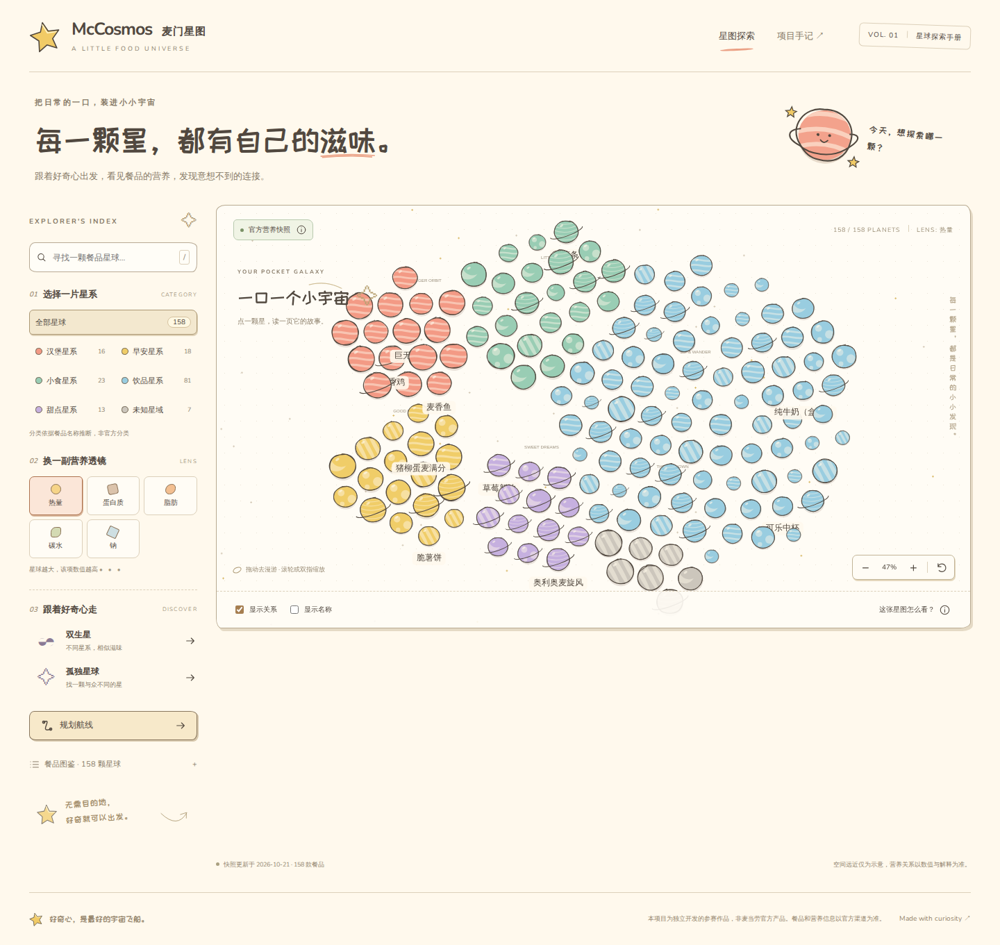

# McCosmos · 麦门星图

把日常的一口，装进小小宇宙。浅色卡通绘本风的麦当劳营养探索应用，让餐品变成星球，用营养透镜发现彼此的连接。

适合想直观看懂餐品营养、喜欢交互图鉴的用户，以及复用 MCP 分析能力的 Agent 开发者。独立参赛作品，非麦当劳官方产品；信息以官方渠道为准。

[在线探索](https://mccosmos.pages.dev) · [Actions 与静态包](https://github.com/ayingQAQ/MCD/actions/workflows/ci.yml) · [实际 MCP 接入](MCP_INTEGRATION.md) · [Skill](skills/mccosmos/SKILL.md) · [实施记录](docs/IMPLEMENTATION_LOG.md)



## 功能

- 拖动/缩放星图、搜索、分类筛选，切换热量/蛋白质/脂肪/碳水/钠五种透镜。
- 营养详情、前三名邻居及数字解释、最少关系跳数航线。
- 跨类别双生星、孤独星球、中文 PNG 星球卡。
- 无运行时大模型、数据库或用户登录；网页无需 Token，CLI/Skill 复用相同算法。

## 安装与启动

需要 Node.js 24+、pnpm 11.21.0。

```sh
pnpm install --frozen-lockfile
pnpm dev
```

打开终端显示的本地地址，默认读取官方快照。

### 下载后离线体验

从成功的 [Actions 运行](https://github.com/ayingQAQ/MCD/actions/workflows/ci.yml)下载 `mccosmos-static`，解压后运行：

```sh
node serve.mjs
```

打开 `http://127.0.0.1:4173`。包内含快照与字体，无需安装依赖、联网或提供 Token。不支持直接双击 index.html，不使用 Service Worker。

### 数据与演示模式

首次项目同步为 **2026-10-21 11:20（北京时间）**：官方接口160条，完全去重后158条。准确时间和数量见界面/快照 meta，非实时在售菜单。

接口未显式声明部分单位和计量基准，因此显示 kcal 及其他指标原始值，不擅自声称每份、每100克或 g/mg。类别本地推断，相近度为工程算法，非官方评价。

通过 `?demo=1` 或来源说明窗口主动进入演示模式，持续标为“合成示例数据 · 非官方营养信息”。官方数据失败只显示错误，不自动伪装回退。合成数据生成器与真实快照隔离。

### 更新快照

在[麦当劳开放平台](https://open.mcd.cn/mcp)登录并激活 Token。设置环境变量 `MCD_MCP_TOKEN`，或把 `.env.example` 复制为 `.env.local` 填入 Token，然后：

```sh
pnpm sync:mcd
```

Token 不带 Bearer 前缀，不进入浏览器或公开仓库。同步失败保留旧快照，仅调用只读营养工具。

## CLI 与 Skill

```sh
pnpm cosmos:cli -- list --category=burger
pnpm cosmos:cli -- neighbors --name="巨无霸" --limit=3
pnpm cosmos:cli -- route --from="巨无霸" --to="双层吉士汉堡"
pnpm cosmos:cli -- discover --kind=twins
pnpm cosmos:cli -- discover --kind=lonely --demo
```

返回 JSON：ok/mode/source/fetchedAt/warnings 和 data/error。失败退出码非零；重名返回候选，请使用 `--id`、`--from-id` 或 `--to-id`。图不连通时可能无路径。

将 `skills/mccosmos` 复制到目标客户端支持的 Skill 目录（Codex 可用 `~/.agents/skills/mccosmos`）。调用时进入已安装依赖的项目目录，详见 SKILL.md；不自动修改客户端配置。

## 验证与部署

每次 push、PR、手动触发均运行 Actions：test → typecheck → lint → build → verify:contest → Playwright。普通 CI 不配置 MCP Token；浏览器测试使用真正的离线静态包，保存1440×900、768×1024、390×844截图和测试报告。

Cloudflare Pages：构建命令 `pnpm build`，输出 `dist`，Node24，无需服务端凭据。也可上传 Actions 产物。在线部署状态见实施记录；没有实际可访问地址前不宣称上线。

## 技术与原创性

React、TypeScript、Vite、Canvas2D、自绘SVG、d3-force、少量Rough.js装饰；Zod和TOON严格适配、MCP SDK同步，Vitest和Playwright验证。

星球、纸张布局和插画为原创。感谢 [Wired Elements](https://github.com/rough-stuff/wired-elements)、[PaperCSS](https://github.com/papercss/papercss)、[Rough.js](https://github.com/rough-stuff/rough) 的线条启发，不套用完整布局。第三方许可见 [THIRD_PARTY_NOTICES.md](THIRD_PARTY_NOTICES.md)。代码 MIT，官方数据、声明和第三方素材各遵守自身条款。

参赛文件见 [官方原文声明](CONTEST_DECLARATION.md) 与 [清单](docs/CONTEST_CHECKLIST.md)。未使用 WorkBuddy，不编造开发记录。
